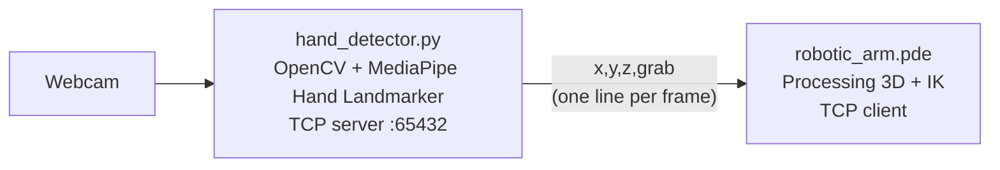

# Visuocontrol of a quasi-static robot

Control a simulated 6-DOF robotic arm with your hands. A webcam tracks both hands with MediaPipe, and a Processing sketch moves the arm in 3D with inverse kinematics. Close your fist to grab a cube.

<!-- Add a demo here: screen-record both windows and save it as docs/demo.gif -->
<!--  -->

## How it works



- **Hand tracking (`hand_detector.py`):** MediaPipe's Hand Landmarker finds 21 landmarks per hand in each frame.
  - **Left hand:** wrist position sets the arm's target X and Y. Closing the fist grabs the cube.
  - **Right hand:** thumbs-up raises the arm, thumbs-down lowers it, at a constant speed while the gesture is held.
- **Gesture rules (`gestures.py`):** a hand counts as a fist when every fingertip is closer to the wrist than its middle joint, so it works whatever way the hand is turned. A thumb gesture needs the other four fingers curled, so an open hand never moves the arm.
- **Streaming:** the tracker runs a TCP server on `127.0.0.1:65432` and sends one newline-terminated `x,y,z,grab` line per frame.
- **Simulation (`robotic_arm.pde`):** Processing connects as a client, solves the joint angles in closed form (law of cosines and `atan2`), and renders the arm, two tables, and a cube from OBJ models. If the hand is closed while the arm touches the cube, the cube follows the arm. Targets out of reach leave the arm fully stretched toward them.

## Requirements

- [Processing 4](https://processing.org/) (uses the built-in `processing.net` library)
- Python 3.9+:
  ```bash
  pip install -r requirements.txt
  ```

The first run downloads MediaPipe's hand model (about 8 MB) into `models/`.

## Running

1. Clone the repo:
   ```bash
   git clone https://github.com/jpcedanos/Visuocontrol-of-a-quasi-static-robot.git
   cd Visuocontrol-of-a-quasi-static-robot
   ```
2. Start the hand tracker:
   ```bash
   python hand_detector.py
   ```
   Options: `--camera N` to pick another webcam, `--host` / `--port` to change the address.
3. Open `robotic_arm.pde` in Processing and press Run.

The two programs can start in any order. The sketch retries the connection every 2 seconds, and the tracker accepts a new connection if the sketch is restarted.

`debug_client.py` prints the stream without the simulation, which is handy for checking the tracker on its own.

## Controls

| Input | Effect |
|---|---|
| Move your left wrist | Moves the arm in X and Y |
| Close your left fist | Grabs the cube when the arm is touching it |
| Right hand thumbs-up / thumbs-down | Raises / lowers the arm (Z) |
| Drag the mouse | Rotates the camera in the Processing window |
| `q` in the camera window | Quits the tracker |

## Tests

The gesture rules and arm-state logic are covered by unit tests with synthetic hands, so they run without a camera:

```bash
python -m pytest
```

## Built with

OpenCV · MediaPipe Tasks · Processing (OpenGL)
