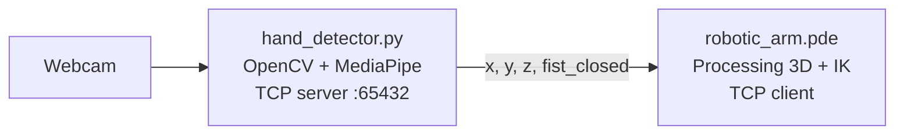

# Visuocontrol of a quasi-static robot

Control a simulated 6-DOF robotic arm with your hand. A webcam tracks your hand with MediaPipe, and a Processing sketch moves the arm in 3D with inverse kinematics. Close your fist to grab a cube.

<!-- Add a demo here: screen-record both windows and save it as docs/demo.gif -->
<!--  -->

## How it works



- **Hand tracking (`hand_detector.py`):** MediaPipe Hands finds the hand landmarks in each frame.
  - Wrist position sets the arm's target X and Y.
  - Thumb up or thumb down moves the target Z up or down.
  - A closed fist is the grab signal.
- **Streaming:** the Python script runs a TCP server on `127.0.0.1:65432` and sends `x,y,z,fist_closed` each frame.
- **Simulation (`robotic_arm.pde`):** Processing connects as a client, solves the joint angles in closed form (law of cosines and `atan2`), and renders the arm, a table, and a cube from OBJ models. If the hand is closed while the arm touches the cube, the arm picks it up.

## Requirements

- [Processing](https://processing.org/) (uses the built-in `processing.net` library)
- Python 3 with `opencv-python`, `mediapipe`, and `numpy`:
  ```bash
  pip install opencv-python mediapipe numpy
  ```

## Running

1. Clone the repo:
   ```bash
   git clone https://github.com/jpcedano/Visuocontrol-of-a-quasi-static-robot.git
   cd Visuocontrol-of-a-quasi-static-robot
   ```
2. Start the hand tracker first, since it's the server:
   ```bash
   python hand_detector.py
   ```
3. Open `robotic_arm.pde` in Processing and press Run. It connects to the tracker and opens the 3D view.

`cliente_temporal.py` is a small debug client that prints the coordinate stream without the simulation.

## Controls

| Input | Effect |
|---|---|
| Move your wrist | Moves the arm in X and Y |
| Thumb up / thumb down | Raises / lowers the arm (Z) |
| Close your fist | Grabs the cube when the arm is touching it |
| Drag the mouse | Rotates the camera in the Processing window |

## Built with

OpenCV · MediaPipe · Processing (OpenGL)
