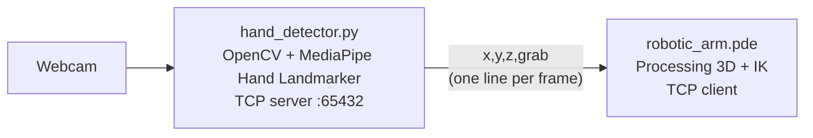

# Visuocontrol of a quasi-static robot

Control a simulated 6-DOF robotic arm with your hands. A webcam tracks both hands with MediaPipe, and a Processing sketch moves the arm in 3D with inverse kinematics. Close your fist to grab a cube.

<!-- Add a demo here: screen-record both windows and save it as docs/demo.gif -->
<!--  -->

## How it works



- **Hand tracking (`hand_detector.py`):** MediaPipe's Hand Landmarker finds 21 landmarks per hand in each frame.
  - **Left hand:** wrist position sets the arm's target X and Y. Closing the fist grabs the cube.
  - **Right hand:** thumbs-up raises the arm, thumbs-down lowers it, at a constant speed while the gesture is held.
- **Gesture rules (`gestures.py`):** a hand counts as a fist when every fingertip is closer to the wrist than its middle joint, so it works whatever way the hand is turned. A thumb gesture needs the other four fingers curled, so an open hand never moves the arm.
- **Streaming:** the tracker runs a TCP server on `127.0.0.1:65432` and sends one newline-terminated `x,y,z,grab` line per frame.
- **Simulation (`robotic_arm.pde`):** Processing connects as a client, solves the joint angles in closed form (law of cosines and `atan2`), and renders the arm, two tables, and a cube from OBJ models. If the hand is closed while the arm touches the cube, the cube follows the arm. Targets out of reach leave the arm fully stretched toward them.

## Quick start (one click)

### 1. Install the prerequisites (once)

- **Python 3.9–3.13.** Anaconda works too. On Windows, if you install from [python.org](https://www.python.org/downloads/), tick "Add python.exe to PATH".
- **[Processing 4](https://processing.org/download).** Any 4.x version works.
- A webcam.

### 2. Get the code

```bash
git clone https://github.com/jpcedanos/Visuocontrol-of-a-quasi-static-robot.git
cd Visuocontrol-of-a-quasi-static-robot
```

### 3. Launch

| System | How |
|---|---|
| Windows | Double-click **`Launch.bat`** |
| macOS / Linux | Run `./launch.sh` in a terminal |

The launcher:
1. Sets up a private Python environment in `.venv` and installs MediaPipe. This takes a minute or two the **first time only**. The hand model (about 8 MB) also downloads on the first run.
2. Finds Processing. If it can't, a window asks you to select **`Processing.exe`** (Processing 4.4 or newer) or **`processing-java.exe`** (older versions). It remembers your choice.
3. Opens the camera window, then the 3D simulation.

To stop, close the 3D window or press **`q`** in the camera window. The launcher closes the other one too.

### Launcher options

Add these after `Launch.bat` (from a terminal) or `./launch.sh`:

| Option | What it does |
|---|---|
| `--check` | Checks the setup and compiles the sketch without opening anything. Good first step if something fails. |
| `--camera 1` | Uses another webcam (0 is the default). |
| `--pick-processing` | Choose the Processing program again, e.g. after updating Processing. |

### Troubleshooting

| Problem | Fix |
|---|---|
| "Python was not found" | Install Python from python.org with "Add python.exe to PATH" ticked, or install Anaconda. |
| "Package installation failed" | Check your internet connection. If your Python is newer than MediaPipe supports, install Python 3.12 and run again. |
| "The hand tracker did not start" | Another app (Zoom, Teams, the browser) may be using the camera. Close it, or try `--camera 1`. |
| "Port 65432 is already in use" | A tracker is already running. Close the other launcher window. |
| Processing opens but the sketch errors | Run `Launch.bat --check` to see the compiler output. |
| Wrong Processing version picked | Run `Launch.bat --pick-processing`. |

## Running the parts by hand

If you prefer not to use the launcher:

1. Install the Python packages:
   ```bash
   pip install -r requirements.txt
   ```
2. Start the hand tracker:
   ```bash
   python hand_detector.py
   ```
   Options: `--camera N` to pick another webcam, `--host` / `--port` to change the address.
3. Open `robotic_arm.pde` in Processing and press Run.

The two programs can start in any order. The sketch retries the connection every 2 seconds, and the tracker accepts a new connection if the sketch is restarted.

`debug_client.py` prints the stream without the simulation, which is handy for checking the tracker on its own.

## Controls

| Input | Effect |
|---|---|
| Move your left wrist | Moves the arm in X and Y |
| Close your left fist | Grabs the cube when the arm is touching it |
| Right hand thumbs-up / thumbs-down | Raises / lowers the arm (Z) |
| Drag the mouse | Rotates the camera in the Processing window |
| `q` in the camera window | Quits the tracker |

## Tests

The gesture rules, the arm-state logic and the launcher are covered by unit tests (with synthetic hands, so no camera is needed):

```bash
pip install -r requirements-dev.txt
python -m pytest
```

## Built with

OpenCV · MediaPipe Tasks · Processing (OpenGL)
