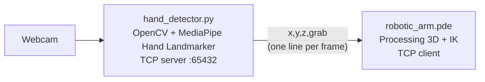

# Visuocontrol of a quasi-static robot

Control a simulated robotic arm with one hand. A webcam tracks your hand with MediaPipe, and a Processing sketch moves a 3-DOF arm (base, shoulder, elbow) with inverse kinematics. Pinch to pick up a Rubik's cube, carry it, and let go: it falls onto a table or the floor.

<!-- Add a demo here: screen-record both windows and save it as docs/demo.gif -->
<!--  -->

## How it works



- **Hand tracking (`hand_detector.py`):** MediaPipe's Hand Landmarker finds 21 landmarks on your hand in each frame.
- **One-hand control (`gestures.py`):**
  - The **palm centre** (wrist and knuckles) moves the arm left/right and up/down. Fingers don't affect it, so pinching doesn't drag the arm.
  - The **apparent size of your hand** sets depth. The size when your hand first appears is the middle; moving it toward the camera reaches deeper into the scene.
  - A **pinch** (thumb and index tips together) grabs. It closes below 0.25 palm sizes and opens above 0.40, so it doesn't flicker at the edge.
  - With several hands in view, it keeps following the one it started with.
- **Streaming:** the tracker runs a TCP server on `127.0.0.1:65432` and sends one newline-terminated `x,y,z,grab` line per frame.
- **Simulation (`robotic_arm.pde`):**
  - Solves the three joint angles in closed form (law of cosines and `atan2`). Out-of-reach targets leave the arm stretched toward them.
  - Picks up the cube when a pinch **starts** with the arm tip at the cube, like a real gripper. The cube then follows the tip.
  - When you let go, the cube falls under gravity and lands on a table top or the floor, with a small bounce.
  - Shadows under the cube and the arm tip show where they are above the ground, which helps to judge depth.
  - A second window shows the scene from above at an angle. Drag the mouse in either window to rotate its view.

## Quick start (one click)

### 1. Install the prerequisites (once)

- **Python 3.9–3.13.** Anaconda works too. On Windows, if you install from [python.org](https://www.python.org/downloads/), tick "Add python.exe to PATH".
- **[Processing 4](https://processing.org/download).** Any 4.x version works.
- A webcam.

### 2. Get the code

```bash
git clone https://github.com/jpcedanos/Visuocontrol-of-a-quasi-static-robot.git
cd Visuocontrol-of-a-quasi-static-robot
```

### 3. Launch

| System | How |
|---|---|
| Windows | Double-click **`Launch.bat`** |
| macOS / Linux | Run `./launch.sh` in a terminal |

The launcher:
1. Sets up a private Python environment in `.venv` and installs MediaPipe. This takes a minute or two the **first time only**. The hand model (about 8 MB) also downloads on the first run.
2. Finds Processing. If it can't, a window asks you to select **`Processing.exe`** (Processing 4.4 or newer) or **`processing-java.exe`** (older versions). It remembers your choice.
3. Opens the camera window, then the 3D simulation.

To stop, close the 3D window or press **`q`** in the camera window. The launcher closes the other one too.

### Launcher options

Add these after `Launch.bat` (from a terminal) or `./launch.sh`:

| Option | What it does |
|---|---|
| `--check` | Checks the setup and compiles the sketch without opening anything. Good first step if something fails. |
| `--camera 1` | Uses another webcam (0 is the default). |
| `--invert-depth` | Moving your hand toward the camera brings the arm nearer instead of deeper. |
| `--pick-processing` | Choose the Processing program again, e.g. after updating Processing. |

### Troubleshooting

| Problem | Fix |
|---|---|
| "Python was not found" | Install Python from python.org with "Add python.exe to PATH" ticked, or install Anaconda. |
| "Package installation failed" | Check your internet connection. If your Python is newer than MediaPipe supports, install Python 3.12 and run again. |
| "The hand tracker did not start" | Another app (Zoom, Teams, the browser) may be using the camera. Close it, or try `--camera 1`. |
| "Port 65432 is already in use" | A tracker is already running. Close the other launcher window. |
| Processing opens but the sketch errors | Run `Launch.bat --check` to see the compiler output. |
| Wrong Processing version picked | Run `Launch.bat --pick-processing`. |

## Running the parts by hand

If you prefer not to use the launcher:

1. Install the Python packages:
   ```bash
   pip install -r requirements.txt
   ```
2. Start the hand tracker:
   ```bash
   python hand_detector.py
   ```
   Options: `--camera N` to pick another webcam, `--host` / `--port` to change the address.
3. Open `robotic_arm.pde` in Processing and press Run.

The two programs can start in any order. The sketch retries the connection every 2 seconds, and the tracker accepts a new connection if the sketch is restarted.

`debug_client.py` prints the stream without the simulation, which is handy for checking the tracker on its own.

## Controls

| Input | Effect |
|---|---|
| Move your palm left/right, up/down | Moves the arm left/right, up/down |
| Move your hand toward / away from the camera | Arm reaches deeper / comes nearer |
| Pinch thumb and index (at the cube) | Grabs the cube |
| Open the pinch | Drops the cube |
| `c` in the camera window | Re-centers depth at your hand's current distance |
| `q` in the camera window | Quits |
| `r` in the 3D window | Puts the cube back on its table |
| Drag the mouse in a 3D window | Rotates that window's view |

Tips:
- Keep your hand at a comfortable distance when it first appears, or press `c` there: that distance becomes the middle depth.
- Watch the purple dot under the arm tip to line it up with the cube before pinching.
- If depth feels backwards, start with `--invert-depth` (`Launch.bat --invert-depth`).

## Tests

The one-hand control rules and the launcher are covered by unit tests (with synthetic hands, so no camera is needed):

```bash
pip install -r requirements-dev.txt
python -m pytest
```

## Built with

OpenCV · MediaPipe Tasks · Processing (OpenGL)
