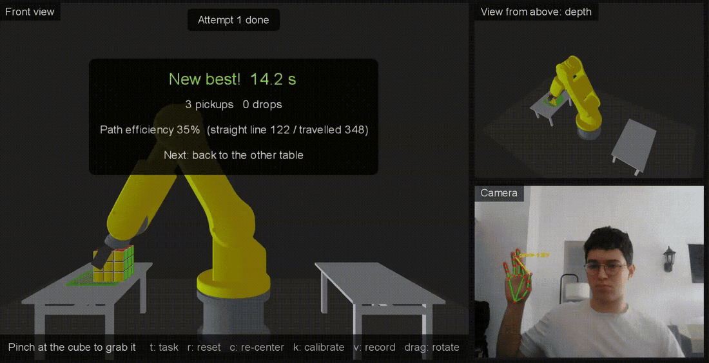
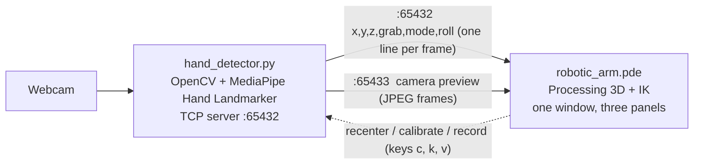

# Visuocontrol of a quasi-static robot

[](https://github.com/jpcedanos/Visuocontrol-of-a-quasi-static-robot/actions/workflows/ci.yml)

Control a simulated robotic arm with one hand. A webcam tracks your hand with MediaPipe, and a Processing sketch moves a 4-DOF arm (base, shoulder and elbow by inverse kinematics, plus a wrist you turn by turning your hand) with a two-finger gripper. Pinch to pick up a Rubik's cube, carry it, turn it, and let go: it falls onto a table or the floor. A task mode times you moving the cube between tables and records every attempt.

<!-- Add a demo here: screen-record the Visuocontrol window and save it as docs/demo.gif -->
<!--  -->

## How it works



- **Hand tracking (`hand_detector.py`):** MediaPipe's Hand Landmarker finds 21 landmarks on your hand in each frame.
- **One-hand control (`gestures.py`):**
  - The **palm centre** (wrist and knuckles) moves the arm left/right and up/down. Fingers don't affect it, so pinching doesn't drag the arm.
  - The **apparent size of your hand** sets depth. Moving it toward the camera reaches deeper into the scene. How much depends on a short [calibration](#calibration) of your camera and distance.
  - **Turning your hand** like a dial turns the wrist (and a held cube). It uses the wrist-to-knuckle direction, so it works with either hand and pinching doesn't change it; turns under 10° are ignored and the wrist stops at ±80°.
  - A **pinch** (thumb and index tips together) grabs. It closes below 0.25 palm sizes and opens above 0.40, so it doesn't flicker at the edge.
  - With several hands in view, it keeps following the one it started with.
  - Positions go through a **One Euro filter**, the usual choice for hand tracking: it smooths heavily while your hand is still and very little while it moves. In the tests it leaves 36% of the jitter of a still hand (a plain 50% moving average leaves 57%) and lags 4.2 units at 200 units/s (the average lags 6.7).
- **Streaming:** the tracker runs a TCP server on `127.0.0.1:65432` and sends one newline-terminated `x,y,z,grab,mode,roll` line per frame, plus the camera preview on port 65433. The sketch sends back short commands when you press keys.
- **Simulation (`robotic_arm.pde`):**
  - Solves the base, shoulder and elbow angles in closed form (law of cosines and `atan2`) so the tool tip reaches the target. Out-of-reach targets leave the arm stretched toward them.
  - A two-finger **gripper** opens, closes on the cube, or closes fully when you pinch on nothing.
  - Picks up the cube when a pinch **starts** with the tool tip at the cube, like a real gripper. The cube slides between the fingers, then moves and turns with them.
  - When you let go, the cube falls (at the angle the gripper held it) and lands flat on a table top or the floor, with a small bounce, keeping its heading.
  - Shadows under the cube and the arm tip show where they are above the ground, which helps to judge depth.
  - Everything is in **one window** that opens centered and sized to your screen:

    ```
    ┌──────────────────────────────┬──────────────┐
    │                              │  View from   │
    │       Front view             │  above       │
    │                              ├──────────────┤
    │                              │  Camera and  │
    │  status · shortcuts          │  your hand   │
    └──────────────────────────────┴──────────────┘
    ```

    The front view is for aiming left/right and up/down, the view from above for judging depth, and the camera panel shows what the tracker sees, with the pinch highlighted. Drag the mouse on either 3D view to rotate it.

## Quick start (one click)

### 1. Install the prerequisites (once)

- **Python 3.9–3.13.** Anaconda works too. On Windows, if you install from [python.org](https://www.python.org/downloads/), tick "Add python.exe to PATH".
- **[Processing 4](https://processing.org/download).** Any 4.x version works.
- A webcam.

### 2. Get the code

```bash
git clone https://github.com/jpcedanos/Visuocontrol-of-a-quasi-static-robot.git
cd Visuocontrol-of-a-quasi-static-robot
```

### 3. Launch

| System | How |
|---|---|
| Windows | Double-click **`Launch.bat`** |
| macOS / Linux | Run `./launch.sh` in a terminal |

The launcher:
1. Sets up a private Python environment in `.venv` and installs MediaPipe. This takes a minute or two the **first time only**. The hand model (about 8 MB) also downloads on the first run.
2. Finds Processing. If it can't, a window asks you to select **`Processing.exe`** (Processing 4.4 or newer) or **`processing-java.exe`** (older versions). It remembers your choice.
3. Opens the **Visuocontrol** window: 3D views plus the camera, all in one place.
4. On the first run, guides you through a 5-second [depth calibration](#calibration) on the camera panel.

To stop, close the Visuocontrol window. The launcher stops the hand tracker too.

### Launcher options

Add these after `Launch.bat` (from a terminal) or `./launch.sh`:

| Option | What it does |
|---|---|
| `--check` | Checks the setup and compiles the sketch without opening anything. Good first step if something fails. |
| `--camera 1` | Uses another webcam (0 is the default). |
| `--invert-depth` | Moving your hand toward the camera brings the arm nearer instead of deeper. |
| `--camera-window` | Also shows the camera in its own window, like older versions. |
| `--pick-processing` | Choose the Processing program again, e.g. after updating Processing. |
| `--calibrate` | Runs the depth calibration again at start (same as `k` in the window). |
| `--record` | Starts recording the session right away. |
| `--replay FILE` | Replays a recording instead of using the camera. Add `--loop`, `--speed 2` or `--recompute` (see [Recordings](#recordings-and-replay)). |

### Troubleshooting

| Problem | Fix |
|---|---|
| "Python was not found" | Install Python from python.org with "Add python.exe to PATH" ticked, or install Anaconda. |
| "Package installation failed" | Check your internet connection. If your Python is newer than MediaPipe supports, install Python 3.12 and run again. |
| "The hand tracker did not start" | Another app (Zoom, Teams, the browser) may be using the camera. Close it, or try `--camera 1`. |
| "Port 65432 is already in use" | A tracker is already running. Close the other launcher window. |
| Processing opens but the sketch errors | Run `Launch.bat --check` to see the compiler output. |
| Wrong Processing version picked | Run `Launch.bat --pick-processing`. |

## Running the parts by hand

If you prefer not to use the launcher:

1. Install the Python packages:
   ```bash
   pip install -r requirements.txt
   ```
2. Start the hand tracker:
   ```bash
   python hand_detector.py
   ```
   Options: `--camera N` to pick another webcam, `--host` / `--port` to change the address. Run by hand, it opens its own camera window (`q` quits, `c` re-centers depth); add `--no-window` to show the camera only inside the sketch.
3. Open `robotic_arm.pde` in Processing and press Run.

The two programs can start in any order. The sketch retries the connection every 2 seconds, and the tracker accepts a new connection if the sketch is restarted.

`debug_client.py` prints the stream without the simulation, which is handy for checking the tracker on its own.

## Controls

| Input | Effect |
|---|---|
| Move your palm left/right, up/down | Moves the arm left/right, up/down |
| Move your hand toward / away from the camera | Arm reaches deeper / comes nearer |
| Pinch thumb and index (at the cube) | Grabs the cube |
| Open the pinch | Drops the cube |
| Turn your hand like a dial | Turns the wrist and the cube it holds |
| `t` | Task mode on / off (on by default) |
| `c` | Re-centers depth at your hand's current distance |
| `k` | Runs the depth calibration again |
| `v` | Starts / stops recording the session |
| `r` | Puts the cube back on its table (and restarts the attempt) |
| Drag the mouse on a 3D view | Rotates that view |
| Close the window | Quits (the launcher stops the tracker too) |

Tips:
- If depth drifts during a session (you leaned back, say), press `c` with your hand at a comfortable distance: that becomes the middle again.
- Line up depth in the **view from above**: the purple dot under the arm tip should sit on the cube before you pinch.
- The status bar tells you whether you're holding the cube, or pinching away from it.
- If depth feels backwards, start with `--invert-depth` (`Launch.bat --invert-depth`).

## Calibration

Cameras and seating distances differ a lot in how much bigger your hand looks when you move it closer. The first time you launch (or when you press `k`), the camera panel walks you through three steps:

1. Hold your hand still at a comfortable distance, upright. Its position becomes the middle of the workspace, its size the middle depth, and its angle the straight wrist.
2. Move it closer to the camera and hold.
3. Move it farther away than at the start and hold.

Each step waits until your hand is steady for 0.8 s, with a progress bar. The arm holds still meanwhile. The result (`calibration.json`) sets the depth sensitivity so that your closest and farthest positions reach 90% of the workspace, and it's reused next time.

## Task mode

The front view shows a green square on the other table. Move the cube onto it:

- The timer starts when you pick the cube up and stops when the cube rests on the square.
- The result card shows the time, pickups, drops to the floor, and **path efficiency**: the straight-line distance from where the cube was to the square, divided by the distance the gripper actually travelled.
- Then the square moves to the other table, so you keep going back and forth. `r` puts the cube back and restarts; `t` switches to free play.

Every attempt is recorded automatically in `recordings/`:

- `attempts.csv`: one row per completed attempt (time, pickups, drops, path length, straight line, efficiency, which table, frames file). Open it in Excel or pandas to see how you improve.
- `attempt_<date>_<time>.csv`: every frame of that attempt: the target sent by the tracker, the joint angles (`base`, `shoulder`, `elbow`, `wrist`), the gripper opening, the tool tip, and the cube's position and heading. These are the same observations and actions a robot-learning dataset uses, so they carry over to a MuJoCo version.

## Recordings and replay

Press `v` (or start with `--record`) to record a session to `recordings/session_<date>_<time>.jsonl`. A red **REC** shows on the camera panel and in the status bar. Press `v` again to save. A file stores your hand landmarks and the arm's target for every frame (under 1 MB per minute). See `recording.py` for the format.

Replay it without a camera:

```bash
Launch.bat --replay recordings/session_20261103_101500.jsonl          # as recorded
Launch.bat --replay recordings/session_20261103_101500.jsonl --loop   # over and over
Launch.bat --replay recordings/session_20261103_101500.jsonl --recompute
```

The camera panel draws your recorded hand. `--recompute` runs the recorded hand through the **current** control code (with the calibration of the recording), which is the way to check how a change to the filter or the pinch thresholds behaves with real movements. Replays are also the easy way to capture a clean demo video.

## Tests

The one-hand control rules, the filter, calibration, recording/replay and the launcher are covered by unit tests (with synthetic hands, so no camera is needed). GitHub Actions runs them on every push and also compiles the sketch:

```bash
pip install -r requirements-dev.txt
python -m pytest
```

## Built with

OpenCV · MediaPipe Tasks · Processing (OpenGL)
